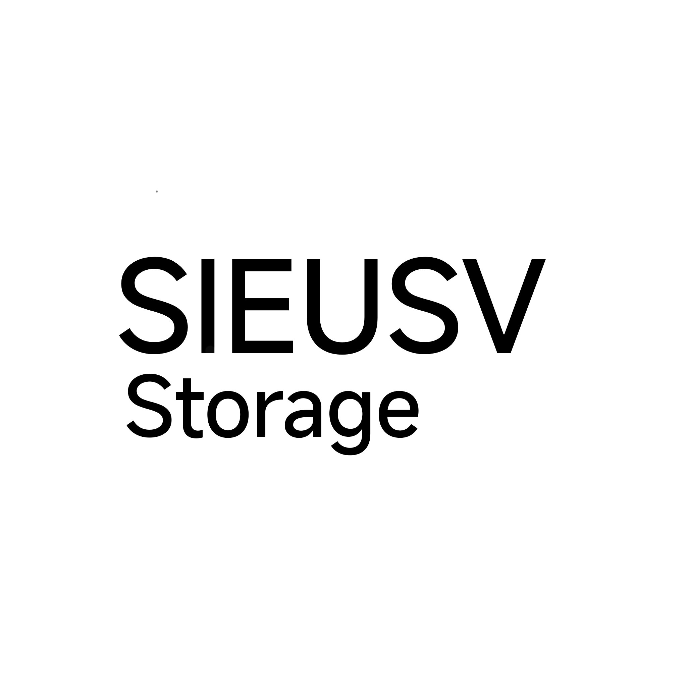

<div align="center">



# SieuSV-Storage

**Source repository for [SIEUSV plugins](https://create.roblox.com/store/asset/124980373269733/SIEUSV-plugins-BETA)**

[](https://create.roblox.com/store/asset/124980373269733/SIEUSV-plugins-BETA)
[](LICENSE.md)
[](#plugins)
[](#how-to-use)

English · [Tiếng Việt](#tiếng-việt)

</div>

---

## About

**SieuSV-Storage** stores the Luau source files and metadata for **SIEUSV plugins**. The plugins are designed to make building and testing Roblox experiences in Studio Lite easier, including on mobile.

Browse, inspect, copy or fork the source files here. The ready-to-use model is available on the [Roblox Creator Store](https://create.roblox.com/store/asset/124980373269733/SIEUSV-plugins-BETA).

## Plugins

| Plugin | Description | Files |
| --- | --- | --- |
| **Advanced Explorer** | In-game Explorer and Properties interface for playtesting. | [Folder](Sieu-SV%20Plugins/Advanced%20Explorer) |
| **Surface Preview** | Displays the X / Y / Z axes and surfaces of a selected part. | [Folder](Sieu-SV%20Plugins/Surface%20Preview) |
| **Weld** | Select parts and create local welds and supported constraints while preserving positions. *(WIP.)* | [Folder](Sieu-SV%20Plugins/Weld) |
| **Grip Editor** | Edit a Tool's `Grip` with Move / Rotate handles and snap settings. Playtest only. | [Folder](Sieu-SV%20Plugins/Grip%20Editor) |
| **Export-Import Plugin** | Export and import plugin instances as code strings. Includes EN/VN guides. | [Folder](Sieu-SV%20Plugins/Export-Import%20Plugin) |
| **Open Chat** | A SIEUSV plugin that toggles the Roblox chat interface. Its website tag is `Github`. | [Folder](Sieu-SV%20Plugins/Open%20Chat) |
| **Automatic Button Arrangement** | Automatically arranges buttons in a scrolling grid. | [Folder](Other/Automatic%20Button%20Arrangement) |
| **Automatically Add UIStroke** | Adds outlines to TextButtons and ImageButtons. | [Folder](Other/Automatically%20Add%20UIStroke) |
| **Draggable** | Adds touch and mouse dragging to supported plugin panels. | [Folder](Other/Draggable) |

## How to use

1. Get the asset ID from the [Roblox Creator Store](https://create.roblox.com/store/asset/124980373269733/SIEUSV-plugins-BETA).
2. Join a Studio Lite playtest.
3. Open Toolbox, paste the asset ID and select **Get**.
4. Find the **Plugins** folder in Workspace.
5. Follow the plugin's guide and place the required scripts in the specified location, usually `StarterPlayer > StarterCharacterScripts`.

Some tools are designed for playtesting only. Check each plugin's folder and README before installing it.

## Library website

[Sieu-Sv_Library](https://sieu-sv-library-api.sieusv-storage-minhreal.workers.dev/) is the read-only web catalog for curated Luau scripts in this repository. It helps visitors discover scripts, inspect source files and review repository history.

- **Search and filters:** search GitHub script names, descriptions and keywords, then filter by category.
- **Source inspection:** open a script page to inspect its Luau source, manifest and repository information.
- **Version history:** GitHub entries show commits that changed each script folder.
- **Google sign-in:** users can create or access a website account through Google OAuth.
- **Account deletion:** signed-in users can select the same Google account again, verify the linked identity and type `DELETE` to remove the website account and its associated active database records.

Community uploads, profile edits, votes and report submissions remain disabled. Existing legacy community records are not served while the read-only pause is active. The site does not delete a user's Google Account or public GitHub history. Read the [Privacy Policy](website/index.html#privacy) and [Terms](website/index.html#terms) before using account features. Review source code and applicable licenses before using or redistributing repository content.

## Pull Request or Website

There are two ways to submit a script to SieuSV-Storage.

### Option 1 — Pull Request (GitHub)

1. Fork this repository and create a branch.
2. Put each plugin or standalone script in its own folder under an appropriate category, such as `Sieu-SV Plugins/` or `Other/`.
3. Add a **`SVS.json`** file (or **`svs.json`**) at the root of that script folder.
4. Add the Luau source files and any supporting documentation to the same folder.
5. Open a Pull Request against `main`. Include a short summary and note any playtest or platform limitations.

After a Pull Request is merged, the website reads its manifest and GitHub history. The script page displays a thumbnail, description and source code directly. The Information panel shows the custom tag, category, upload method, repository path, contributor profiles and collapsed PR history.

#### SVS.json format

Manifest paths are relative to the folder containing the JSON file. Use valid JSON (double quotes, no trailing commas).

```json
{
  "schema_version": 1,
  "id": "my-script",
  "title": "My Script",
  "description": "What the script does.",
  "category": "Plugins",
  "tag": "Github",
  "method": "source",
  "source": "Main.lua",
  "files": [
    { "path": "Main.lua", "role": "main" },
    { "path": "Helper.lua", "role": "helper" }
  ],
  "import_parts": [],
  "thumbnail": null
}
```

- `id`: unique, lowercase identifier.
- `title`, `description`, `category`: information shown in the library. Use `Plugins` for plugins and `Other` for utility scripts.
- `tag`: a custom display tag. Defaults to `Github` when omitted. All current repository scripts, including Open Chat, use `Github`.
- `method`: `source`, `import` or `both`.
- `source`: relative path to the main `.lua` or `.luau` file when using `source` or `both`.
- `files`: source and supporting files associated with the script. Each path is relative to the manifest folder. Use roles such as `main`, `helper`, `documentation` or `button`.
- `import_parts`: relative paths to String Import part files when using `import` or `both`.
- `thumbnail`: optional relative image path; use `null` when there is no thumbnail.

The website accepts either exact filename `SVS.json` or `svs.json`. Keep credentials, private URLs and personal information out of manifests and source files. Do not submit code you do not own or have permission to share.

### Option 2 — Website

Website uploads are **temporarily paused**. Use the GitHub Pull Request process above to propose a script. The website will remain read-only until its legal, privacy and security requirements have been reviewed.

## Repository structure

```text
SieuSV-Storage/
├── .github/
│   ├── ISSUE_TEMPLATE/
│   │   └── bug_report.md
│   └── PULL_REQUEST_TEMPLATE.md
├── docs/
│   ├── README.md
│   ├── manifest.md
│   ├── api.md
│   └── legal-readiness.md
├── Other/
│   ├── Automatic Button Arrangement/
│   ├── Automatically Add UIStroke/
│   └── Draggable/
├── Sieu-SV Plugins/
│   ├── Advanced Explorer/
│   ├── Export-Import Plugin/
│   ├── Grip Editor/
│   ├── Open Chat/
│   ├── Surface Preview/
│   └── Weld/
├── website/
│   └── migrations/
│       └── 0002_session_version.sql
├── CONTRIBUTING.md
├── LICENSE.md
└── README.md
```

## Contributing

Found a bug or want to add a plugin? Open an [**Issue**](https://github.com/minhReal/SieuSV-Storage/issues) or a **Pull Request** against `main`. Read [`CONTRIBUTING.md`](CONTRIBUTING.md) for the workflow and review checklist, and see [`docs/`](docs/) for the manifest and API references. Independent plugins you add remain the property of their creators (see the license).

## License

Licensed under the **SIEUSV Attribution License 1.0 (SAL-1.0)** — see [`LICENSE.md`](LICENSE.md).

You may use, modify and commercialize derivatives, but you **must credit the original authors** and link back to this project.

## Credits

- **minh152680 / minhminhminh6736** — [YouTube](https://www.youtube.com/@minh15268O)
- **Ba K gang** — [Roblox Group](https://www.roblox.com/communities/434674101/Ba-K-gang#!/about)

---

## Tiếng Việt

<details>
<summary><b>Bấm để xem bản tiếng Việt</b></summary>

### Giới thiệu

**SieuSV-Storage** là repository lưu trữ mã nguồn Luau và metadata cho **SIEUSV plugins**. Các plugin được thiết kế để hỗ trợ xây dựng, chỉnh sửa và kiểm thử trải nghiệm Roblox bằng Studio Lite, bao gồm cả môi trường sử dụng trên điện thoại.

Repository này là nơi lưu source code, manifest và tài liệu của từng plugin. Bạn có thể xem mã nguồn, sao chép, fork repository hoặc gửi đóng góp. Model đóng gói sẵn có trên [Roblox Creator Store](https://create.roblox.com/store/asset/124980373269733/SIEUSV-plugins-BETA).

### Danh sách plugin và script

| Plugin / Script | Chức năng | Thư mục |
| --- | --- | --- |
| **Advanced Explorer** | Giao diện Explorer và Properties trong lúc playtest để kiểm tra Instance. | [Thư mục](Sieu-SV%20Plugins/Advanced%20Explorer) |
| **Surface Preview** | Hiển thị trục X / Y / Z và bề mặt của Part đang chọn. | [Thư mục](Sieu-SV%20Plugins/Surface%20Preview) |
| **Weld** | Chọn Part và tạo weld hoặc constraint được hỗ trợ mà vẫn giữ vị trí. *(Đang phát triển.)* | [Thư mục](Sieu-SV%20Plugins/Weld) |
| **Grip Editor** | Chỉnh thuộc tính `Grip` của Tool bằng tay nắm Move / Rotate và thiết lập snap. Chỉ dùng trong playtest. | [Thư mục](Sieu-SV%20Plugins/Grip%20Editor) |
| **Export-Import Plugin** | Xuất và nhập Instance của plugin bằng chuỗi code. Có hướng dẫn EN/VN. | [Thư mục](Sieu-SV%20Plugins/Export-Import%20Plugin) |
| **Open Chat** | Plugin SIEUSV dùng để bật hoặc tắt giao diện chat Roblox. Tag trên website là `Github`. | [Thư mục](Sieu-SV%20Plugins/Open%20Chat) |
| **Automatic Button Arrangement** | Tự động sắp xếp button theo dạng scrolling grid. | [Thư mục](Other/Automatic%20Button%20Arrangement) |
| **Automatically Add UIStroke** | Tự thêm outline cho TextButton và ImageButton. | [Thư mục](Other/Automatically%20Add%20UIStroke) |
| **Draggable** | Thêm khả năng kéo thả bằng cảm ứng hoặc chuột cho các panel được hỗ trợ. | [Thư mục](Other/Draggable) |

### Cách sử dụng model trên Roblox

1. Mở [Roblox Creator Store](https://create.roblox.com/store/asset/124980373269733/SIEUSV-plugins-BETA) và sao chép Asset ID.
2. Tham gia một phiên playtest trong Studio Lite.
3. Mở Toolbox, dán Asset ID rồi chọn **Get**.
4. Tìm thư mục **Plugins** trong Workspace.
5. Mở thư mục của plugin cần dùng và đọc README hoặc hướng dẫn đi kèm.
6. Đặt từng Script / LocalScript vào đúng vị trí được hướng dẫn. Vị trí thường gặp là `StarterPlayer > StarterCharacterScripts`, nhưng không phải plugin nào cũng sử dụng vị trí này.
7. Kiểm tra Output và thử chức năng trong môi trường playtest trước khi dùng trong dự án chính.

Một số plugin phụ thuộc vào cấu trúc GUI, quyền truy cập hoặc môi trường playtest cụ thể. Không nên giả định mọi script đều hoạt động khi đặt ở cùng một vị trí.

### Website Sieu-Sv_Library

[Sieu-Sv_Library](https://sieu-sv-library-api.sieusv-storage-minhreal.workers.dev/) là website catalog chỉ đọc để tìm kiếm và xem source Luau đã được tuyển chọn từ repository này.

- **Tìm kiếm và lọc:** tìm script GitHub theo tên, mô tả, từ khóa và category.
- **Xem source:** mở trang script để kiểm tra mã nguồn, manifest và thông tin repository.
- **Lịch sử phiên bản:** xem các commit đã thay đổi thư mục script trên GitHub.
- **Google sign-in:** tạo hoặc truy cập tài khoản website qua Google OAuth.
- **Delete Account:** người dùng đã đăng nhập chọn lại đúng Google account liên kết, xác minh danh tính và nhập `DELETE` để xóa tài khoản cùng dữ liệu liên quan trong database đang hoạt động.

Upload cộng đồng, chỉnh sửa hồ sơ, vote và report vẫn bị tắt. Dữ liệu cộng đồng cũ không được cung cấp qua website trong thời gian duy trì read-only. Xóa tài khoản website không xóa Google Account, lịch sử GitHub công khai, fork hoặc bản sao do bên thứ ba lưu giữ. Đọc [Privacy Policy](website/index.html#privacy) và [Terms](website/index.html#terms) trước khi dùng các tính năng tài khoản.

### Đóng góp bằng GitHub Pull Request hoặc Website

Có hai cách gửi script lên SieuSV-Storage.

#### Cách 1 — GitHub Pull Request

1. Fork repository `minhReal/SieuSV-Storage`.
2. Tạo branch riêng cho thay đổi của bạn để dễ quản lý nhiều thay đổi.
3. Tạo một thư mục riêng cho mỗi plugin hoặc script độc lập trong category phù hợp, ví dụ `Sieu-SV Plugins/` hoặc `Other/`.
4. Thêm file **`SVS.json`** hoặc **`svs.json`** vào thư mục gốc của script.
5. Đặt source code Luau, file phụ trợ, thumbnail và hướng dẫn cần thiết trong cùng thư mục.
6. Kiểm tra JSON hợp lệ, đường dẫn file đúng, không chứa token, mật khẩu, URL riêng tư hoặc thông tin cá nhân.
7. Mở Pull Request và đặt base branch là **`main`**. Mô tả chức năng, cách cài đặt, kết quả test và giới hạn đã biết.
8. Chờ maintainer review. Có thể cần sửa đổi trước khi PR được merge.

Sau khi PR được merge, website sẽ đọc manifest từ repository. Trang script có thể hiển thị thumbnail, mô tả, source code, category, tag, phương thức upload, đường dẫn thư mục GitHub, contributor và lịch sử Pull Request.

#### Định dạng `SVS.json`

Đường dẫn trong manifest được tính tương đối từ thư mục đang chứa file JSON. Dùng JSON hợp lệ, key và string phải có dấu ngoặc kép, không thêm dấu phẩy ở phần tử cuối.

```json
{
  "schema_version": 1,
  "id": "my-script",
  "title": "My Script",
  "description": "What the script does.",
  "category": "Plugins",
  "tag": "Github",
  "method": "source",
  "source": "Main.lua",
  "files": [
    { "path": "Main.lua", "role": "main" },
    { "path": "Helper.lua", "role": "helper" }
  ],
  "import_parts": [],
  "thumbnail": null
}
```

Các trường chính:

| Classname | Bắt buộc | Mô tả |
| --- | --- | --- |
| `schema_version` | Khuyến nghị | Phiên bản cấu trúc manifest. Hiện dùng `1`. |
| `id` | Khuyến nghị | ID duy nhất, viết thường, dùng chữ cái, số và dấu gạch ngang. |
| `title` | Khuyến nghị | Tên hiển thị của script. |
| `description` | Không | Mô tả ngắn về chức năng. |
| `category` | Không | Category hiển thị. Dùng `Plugins` cho plugin và `Other` cho tiện ích. |
| `tag` | Không | Tag tùy chỉnh. Mặc định là `Github` nếu bỏ trống. |
| `method` | Không | `source`, `import` hoặc `both`. Mặc định là `source`. |
| `source` | Theo method | Đường dẫn tới file Lua/Luau chính khi dùng `source` hoặc `both`. |
| `files` | Khuyến nghị | Danh sách file source và file phụ. Mỗi phần tử có `path` và `role`. |
| `import_parts` | Theo method | Danh sách đường dẫn file String Import khi dùng `import` hoặc `both`. |
| `thumbnail` | Không | Đường dẫn ảnh tương đối. Dùng `null` nếu không có ảnh riêng. |

- Website chấp nhận chính xác tên file `SVS.json` hoặc `svs.json`.
- `method: "source"` cần `source` trỏ tới file Luau chính.
- `method: "import"` cần ít nhất một file trong `import_parts`.
- `method: "both"` cần cả source và import parts.
- Mỗi đường dẫn phải trỏ đến file thực sự tồn tại trong repository và nằm trong thư mục script.
- `files` có thể dùng role như `main`, `helper`, `documentation`, `button` hoặc `manifest`.
- Nếu không khai báo thumbnail hợp lệ, website sẽ sử dụng ảnh mặc định `thumDefault.jpg`.
- Không đưa secret, access token, mật khẩu, thông tin cá nhân hoặc mã nguồn không có quyền chia sẻ vào repository.

#### Cách 2 — Website

Chức năng upload qua website hiện **tạm thời bị tắt**. Hãy dùng quy trình GitHub Pull Request ở trên để đề xuất script. Website sẽ duy trì chế độ chỉ đọc cho đến khi các yêu cầu pháp lý, quyền riêng tư và bảo mật được rà soát.

### Cấu trúc repository

```text
SieuSV-Storage/
├── .github/
│   ├── ISSUE_TEMPLATE/
│   │   └── bug_report.md
│   └── PULL_REQUEST_TEMPLATE.md
├── docs/
│   ├── README.md
│   ├── manifest.md
│   └── api.md
├── Other/
│   ├── Automatic Button Arrangement/
│   ├── Automatically Add UIStroke/
│   └── Draggable/
├── Sieu-SV Plugins/
│   ├── Advanced Explorer/
│   ├── Export-Import Plugin/
│   ├── Grip Editor/
│   ├── Open Chat/
│   ├── Surface Preview/
│   └── Weld/
├── website/
├── CONTRIBUTING.md
├── LICENSE.md
└── README.md
```

### Đóng góp và báo lỗi

Bạn có thể mở [GitHub Issue](https://github.com/minhReal/SieuSV-Storage/issues) để báo lỗi hoặc đề xuất tính năng, hoặc tạo Pull Request để đóng góp trực tiếp.

Trước khi gửi thay đổi, hãy đọc [CONTRIBUTING.md](CONTRIBUTING.md), hướng dẫn trong [docs/](docs/) và template tương ứng. Plugin độc lập do cộng tác viên tạo vẫn thuộc quyền của tác giả theo điều khoản giấy phép.

### Giấy phép

Repository sử dụng **SIEUSV Attribution License 1.0 (SAL-1.0)**. Đọc đầy đủ tại [LICENSE.md](LICENSE.md).

Bạn có thể sử dụng, chỉnh sửa và thương mại hóa các sản phẩm phái sinh theo điều kiện của giấy phép, nhưng **phải ghi công tác giả gốc và dẫn liên kết trở lại dự án**.

### Credits

- **minh152680 / minhminhminh6736** — [YouTube](https://www.youtube.com/@minh15268O)
- **Ba K gang** — [Roblox Group](https://www.roblox.com/communities/434674101/Ba-K-gang#!/about)

</details>
